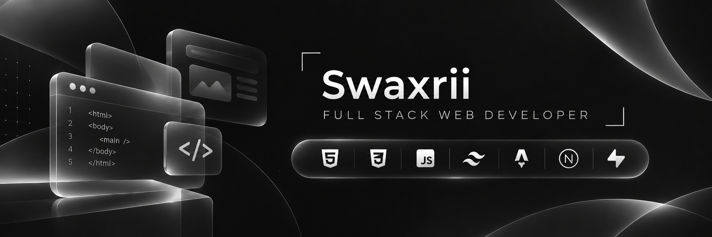

# Hi, I'm Swaxrii 👋

**Full Stack Web Developer**

I build modern, responsive, and performant web applications with a focus on clean code, intuitive design, and maintainable architecture.

## Tech Stack

**Frontend & Frameworks**

**Backend & Database**

**Tools & Workflow**

## What I Do

- **Frontend Development** — Responsive, accessible, and modern interfaces.
- **Backend Development** — APIs, databases, and application logic.
- **Software Architecture** — Clean, scalable, and maintainable code.
- **UI/UX Design** — Intuitive and visually consistent experiences.
- **Optimization** — Performance, SEO, and accessibility.
